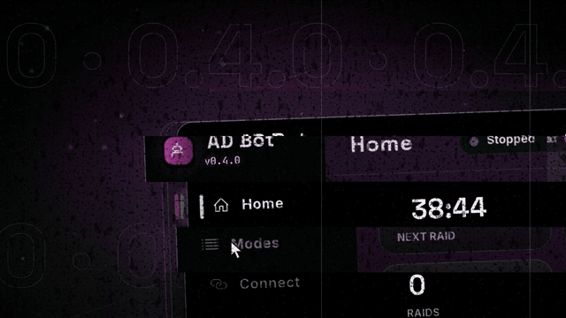
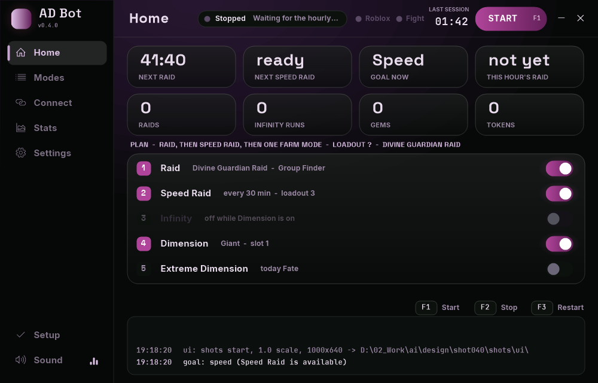
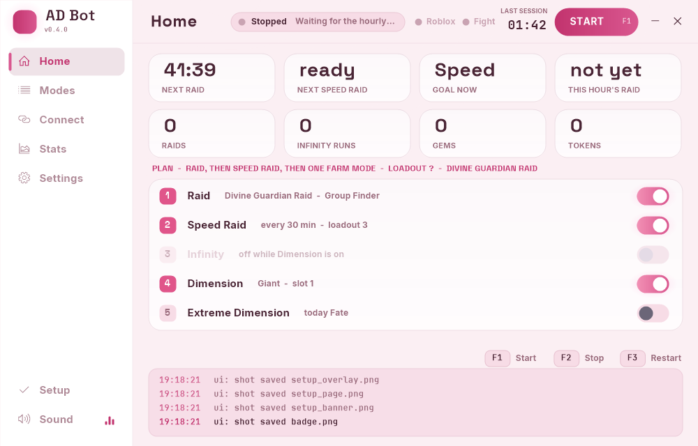

# AD/BOT

**Farming bot for Anime Dimensions Simulator (Roblox) that keeps going when Roblox itself fails.**

Use this button, not the green <b>Code → Download ZIP</b>: here the folder is named after the version (<code>AD-bot-0.4.2</code>), so you always know which build you have.

> [!WARNING]
> **The browser or Windows Defender may block the download and call it a virus. It is a false alarm.**
> What triggers it is the **Discord webhook** (`webhook.ahk`): the bot can send its reports to your Discord channel, and antivirus programs do not like scripts that send data to the internet. It only sends when you put your own webhook link in **Discord**, and only to that link. Every file is a plain-text `.ahk` script, so you can open it and read what it does.
> To download anyway: in Chrome open **Downloads** and press **Keep**; in Windows Defender open **Protection history** and press **Allow**.

> Roblox disconnects, freezes on a teleport, loops a retry screen or just closes? AD/BOT was made for players for whom this happens **all the time**. It notices the problem, restarts the game, joins again and carries on, so your night run does not end at the first crash.

## 🆕 New in 0.4.2

| | |
|---|---|
| 🗿 **Combat Giant Raid** | The new limited raid: pick **Combat** in the raid list. |
| 🧹 **Old raids removed** | Infinity Shiro, Saiya Ultra Instinct and Cursed Sage left the game. If you had one picked, the bot switches to Divine. |
| 🔮 **Esper Raid** | The new limited raid: pick **Esper** in the raid list. |
| 🧭 **Dimension through Group Finder** | Dimension page, **Entry: Group Finder** - pick the map, the difficulty (Easy / Hard / Nightmare) and **HC** (Hardcore); the bot joins a group and waits on the queue banner. Halloween is always Nightmare without Hardcore. |
| ⚡ **Stronger raid start with Auto** | Raid and Speed Raid: 2 s after Auto turns on, the bot presses **5** (if your character has it), then **E R X Z** - once per run, nothing else. |
| 📰 **What's new card** | After an update the bot shows what was added, changed, removed or fixed. Close it with the X. |

## 🆕 New in 0.4.1

| | |
|---|---|
| ⬆️ **UPDATE button** | The bot checks GitHub by itself. When a new version is out, a green **UPDATE** button shows up: one click downloads it, keeps your settings and recorded runs, and restarts the bot. (Download 0.4.1 by hand once - from then on the button does it.) |
| ⚡ **Faster Auto** | Auto is pressed about 1 s after a Raid, Speed Raid or Infinity run starts (was up to 15-50 s). The bot also knows the AUTO button by its colours, so a game update cannot hide it again. |
| 🛡️ **Never closes a running raid** | While the AUTO button is on screen the bot does no lobby or menu actions, no Safe mode restart, no Esc - a false "lobby" can no longer close your raid. |
| 🚪 **Speed Raid LEAVE** | After a Speed Raid the bot presses LEAVE right after the rewards are read, instead of waiting ~15 s for the teleport. |
| ⏱️ **Wait after REPLAY** | Dimension page: set how many seconds Halloween, Death and other recorded Dimensions wait after REPLAY (was a fixed 15 s). |
| 🎛️ **Recorder 2.0 fixed** | No lost or stuck keys, camera turns recorded over RDP, no camera drift up on clicks, exact 1 ms timing, middle and side mouse buttons, your Windows mouse settings used for the replay. Record your runs again for the best result. |
| 🔑 **Roblox Sign In page** | If the Roblox app logs itself out, the bot starts the game through your browser instead of waiting on the Sign In page. |
| 📊 **Bot counter** | While the bot farms, it sends a random number (its id) to the author's counter once an hour, so we can see how many bots run. No name, no account, no game data; no IP is stored. |

## ✨ New in 0.4.0

| | |
|---|---|
| 🎨 **HUD 2.0** | A new full window: Home, Modes, Connect, Stats, Settings and Setup pages, a plan of what the bot does next, animations, click sounds and 9 themes. The compact window is still there. |
| 🛡️ **Safe mode** | When the same mode keeps failing, the bot restarts the game, and after the 3rd problem in 2 hours it pauses that mode for a while and farms something else. |
| 🔁 **Auto rejoin** | A frozen game (Not Responding, or the same picture for 3 minutes) is restarted, and a watchdog starts the bot again if it hangs. Your private server link is used after every restart. |
| 🎛️ **Recorder 2.0** | A new, simpler recorder that records every move and plays it back. |
| 📦 **Share runs** | Export your run to one `.adrun` file and Import a friend's run in the Recorder. |
| 🔥 **Extreme knows today's map** | The bot knows which Extreme map is open today and plays your own run for that map. |
| 💬 **Discord reports** | Put your webhook link in **Discord**: the bot posts what it did (raids, gems, problems), so you can watch it from your phone. |
| ⚔️ **Create room is back** | Raids can use your own room again, besides Group Finder. |
| ⏱️ **Raid start minute** | Your time zone is not a full hour away? Set the minute the raid opens (Modes > Raid, xx:00 by default). |

 HUD 2.0: the Home page in the dark and the light theme

<b>New in 0.3.5</b>

| | |
|---|---|
| 🔥 **Extreme Dimension** | Enters from the lobby, picks Easy / Normal / Nightmare / Extreme, presses Start, waits **Wait after Start** (15 s, also after Replay) and plays your recording from `dimension\extreme`. **It ships empty: record your own run.** While it is on, the normal Dimension is off. Uses loadout 2. |
| 🎃 **Halloween and Death Dimension** | New choices next to Giant. **No runs are included** - record your own with the Recorder. |
| 🗿 **Giant Dimension slots** | All 5 slots are yours (`dimension\giant`, `giant2`-`giant5`). An empty slot plays the built-in run; UPDATE never writes into a slot. |
| ⚔️ **Raid picker and Group Finder** | Pick the raid from a list. The bot joins it through Group Finder and waits in the queue. |
| ⏱️ **LEAVE AT** | In System: the minute and second of the hour when the bot leaves for the raid. |
| 🩺 **Better Setup check** | Checks that Roblox runs first, then really looks for the PLAY button, reads the scale of the monitor the game is on, warns about a self-hiding taskbar. After **Stop**, a yellow plate tells what went wrong and how to fix it. |
| 🌗 **Light theme** | Sun / moon switch at the top of the compact window. |

> **Loadouts:** keep the original names in the Bag - **Loadout 1** (raid), **Loadout 2** (Infinity, Dimension, Extreme), **Loadout 3** (Speed Raid). Do not rename them: the bot finds them by name.

<b>New in 0.3.1</b>

| | |
|---|---|
| 🪟 **New compact interface** | A small window with all settings in fold-out groups. Opens by default after the first Setup check. |
| 🖥️ **Classic interface, improved** | Still here: **FULL UI** in the System group or **CHARACTER & STATS**. |
| 🗿 **Giant Dimension** | Plays a recorded run instead of Infinity. Each slot plays your own recording; an empty slot plays the built-in run. |
| 🎛️ **Recorder** | `Edit the run`: Wait +/-100 ms, add key press / key down / key up, edit or delete rows. |
| 🎵 **Music** | Plays in the compact window. Turn it off in System > MUSIC, or add your own `.m4a` to `music`. |
| 🧭 **Smarter lobby check** | Lobby is also found by the **BAG** text when PLAY cannot be read (e.g. under the "Activate Windows" watermark). |
| 🔗 **Private server links** | Old `privateServerLinkCode` links open straight in Roblox; a failed link falls back to the plain game start. |

## 🩹 Recent fixes

- **Running from inside the ZIP (28.11, players)** - started straight from the archive, the bot ran a temporary copy, so settings, logs and updates got lost. Now the Setup check shows a red line and Start is blocked until the archive is extracted.
- **Recording step count (26.11, players)** - the Dimension page said 125 steps while the Recorder listed 79 for the same run. It now counts the steps the same way as the Recorder.
- **Dimension Nightmare on Sword, Fate and other maps (25.11, players)** - on maps with only Easy and Nightmare the bot clicked the empty 3rd row of the difficulty list, so Nightmare was never set and the run did not start. It now tries row 3, 2 and 1 and checks that Nightmare is picked.
- **Quest rewards no longer stuck (24.11, players)** - the last Complete button was cut off by the bottom of the quest list and the click missed it; the bot now scrolls it up first.
- **No more "raid" in the lobby (24.11)** - a bright skin standing over the AUTO button spot was taken for a running raid and the bot waited for ever. The AUTO colours now count only during a real fight.
- **Giant detection switch removed (24.11)** - Giant starts like the other maps: ENEMIES LEFT, then **Start after ENEMIES LEFT**.
- **Giant starts like Extreme (22.11)** - with Giant detection off the bot no longer waits a fixed time after REPLAY: it waits for ENEMIES LEFT, then **Start after ENEMIES LEFT** seconds (Dimension page, default 3 s). "Wait after REPLAY" is gone.
- **Extreme Dimension card found on more screens (22.11, players)** - on some PCs the game text EXTREME was read as "EXTQEME", so the bot never opened the card and restarted Roblox again and again. Small misreads like that are accepted now.
- **Restart if no RETRY setting (22.11, players)** - long Dimension runs (Death) were cut by a Roblox restart 2 min after the start. Dimension page: set how many minutes the bot waits for the results before it restarts Roblox (default 2, 0 = off).
- **Shift Lock in the Recorder (22.11)** - tick **Shift Lock** in the Recorder to record every mouse move and the Shift key. Start the replay with Shift Lock in the same state as when you recorded.
- **Start delay removed (22.11)** - it did the same as the wait settings below it on the Dimension page.
- **Session card in the webhook, accessories counted (21.11)** - on Stop the webhook post now has a picture of the Session card next to the run summary. Dimension accessories (Giant, ...) are counted when ACCESSORY PITY drops back to 0, shown in the Session card, the run summary and the stats.
- **Extreme Dimension card read again (21.11, players)** - with a new event card on top of the modes menu the bot sometimes did not read the EXTREME DIMENSION card and stood in the menu; it now looks 3 times and logs what it saw.

- **Recording speed is saved (19.11, players)** - set **Speed %** in the Recorder (e.g. 92) and press Save: the speed is kept in the run file and the bot plays the run at that speed too.
- **Dimension card click higher (19.11, players)** - the bot clicks near the top of the DIMENSION card, so an open chat no longer covers it.
- **Fewer restarts, no missed raids (18.11)** - Giant no longer restarts Roblox every few runs ("RETRY / LEAVE does not work"); a stuck Extreme run restarts 3 min after the recording, not 10; no skills on the Extreme results; the raid is no longer missed when the Dimension window was open at raid time; no new Infinity in the last 3 min before the raid; anti-AFK with the game's Auto (Error 278) and a faster disconnect check; safer Auto presses by colour; the HUD and webhook wait while a recording plays; correct Dimension run counts; the webhook logs failed posts; the auto-start no longer stops with an error window.

- **No skills at the start of an Extreme run (17.11, players)** - started (F1) inside a run, the bot first looks at the AUTO button: with it, it is a raid; without it, a Dimension - the recorded run plays from its start, also at raid time (then LEAVE on the results and the raid). In Extreme, skills come only after the recorded run, never before it.
- **Extreme and Dimension runs start reliably (17.11, players)** - Extreme and the simple Dimensions (Halloween, Death, ...) now start the recorded run when **ENEMIES LEFT** shows (+2 s, set on the Extreme / Dimension page), not after a fixed timer. Press F1 right after REPLAY and the run plays from the beginning - no more random skills. The Recorder starts by itself at ENEMIES LEFT, skips Shift (Shift Lock) and records mouse moves only with the right button held. Tip: record with the keyboard only for a stable run.
- **Extreme stats and crystals (17.11)** - Extreme is counted on its own (Home, Stats, session summary) and its red crystals are read from the results; with **Raid wins** on, the webhook posts an **EXTREME WON** card. Optional: **Use Loadout 3** for Extreme while Speed Raid is off.
- **Quest rewards (17.11)** - turn on **Quest rewards** (Modes > General): in the lobby the bot takes finished Daily / Weekly quests (red ! on QUEST). Off by default.
- **Smaller fixes (17.11)** - held skills in a recorded run are pressed until they fire; the DIMENSION card is clicked higher (chat no longer covers it); restart messages name the right mode; a switch that turns another mode off now shows a "!" on that tab.
- **Raid win card in Discord (16.11, players)** - turn on **Raid wins** on the Connect page: after every raid win the webhook posts a card with gems, tokens, fight time, session totals and the rewards screenshot. Off by default; with it on, **Send test** shows a sample card.
- **New Helper tab: Skill buffer (15.11)** - for playing by hand: turn on **Skill buffer** on the new **Helper** page, stop the bot (F2) and hold skill keys in Roblox. Each held skill is pressed again and again until you let go, so it fires the moment its cooldown ends. Several keys at once work; click a key on the page to leave it out.
- **Giant Dimension slot 1 has a run again (15.11)** - a new download comes with the author's Giant run in slot 1 (`dimension\giant\log.txt`, keyboard only). UPDATE puts it only into an empty slot 1 and never over your own recording.
- **Raid started by hand now gets Auto (15.11, players)** - a raid started by hand from the lobby right after a Dimension was taken for the Dimension: skills were pressed and Auto never. The bot now treats a fight after the lobby as the current goal.
- **New raid: Tengu Raid (14.11, players)** - pick **Tengu** in the raid list; the bot finds it by name in Create and in Group Finder.
- **Extreme Dimension no longer cancelled (14.11, players)** - a PLAY-like picture seen right after Start cancelled the run, so only the skills were pressed. Extreme now always waits and plays the run.
- **Infinity: Reset to Assist 1 (14.11, players)** - new optional switch on the Infinity page: once at the start of each run the bot presses Esc-R-Enter, so Assist 1 comes out (one character can be both main and assist). Off by default.
- **Giant detection switch (14.11, players)** - Dimension page: **Giant detection** on = Giant waits for the giants on screen after RETRY (as before); off = the run starts **Wait after REPLAY** seconds after RETRY, with no extra waits. The wait row is greyed out while detection is on.
- **Raid: failed teleport (14.11, players)** - when the game answers "Failed to teleport. Exit the teleporter and try again" the modes window stayed open and the bot took the PLAY button behind it for the lobby. Now it closes the window after 6 s and tries again.
- **Auto in a raid starts faster (14.11, players)** - a quick watcher presses AUTO about half a second after the button shows, instead of waiting for the next bot step (1-2 s).
- **LEAVE not pressed (14.11)** - after Speed Raid (and sometimes Infinity) the LEAVE picture did not match, so the bot waited ~15 s for the teleport. A new LEAVE picture made from two real results screens fixes it.
- **Wait after REPLAY (14.11, players)** - new setting on the Dimension page (1-60 s, was a fixed 15 s): how long Halloween, Death and other recorded Dimensions wait after REPLAY before the run starts. Extreme keeps its own **Wait after Start**.
- **Update loading screen (14.11, players)** - UPDATE now shows an animated loading screen (Download, Unpack, Install, Restart) and the bot is locked until it is done: no clicks, no F1-F3, no closing. Updates are also much faster (a few seconds) and never stop on a song that is playing. It shows from the next update on.
- **UPDATE in the bar over the game (14.11, players)** - while the bot farms, the small bar over the game shows a green **UPDATE ready · F2** when a new version is out: stop with F2 and press **UPDATE** in the window.
- **New sounds, full window first (14.11, players)** - calmer, quieter button sounds; a new download opens the full window after Setup instead of the compact one.
- **Version in the folder name (14.11, players)** - the Download link at the top gives a folder named `AD-bot-0.4.1`.
- **No author runs in the download (14.11)** - the bot no longer ships the author's Giant Dimension runs (Slot 1 and Slot 3), so UPDATE can never put them into your empty slots. Your own recordings are never touched. Giant without a recording uses the built-in route.
- **Bot counter (14.11)** - the bot sends a random id once an hour while it farms, so the author can see how many bots run. Nothing else is sent.
- **Raid closed by the bot (14.11)** - after a game update the AUTO button pictures stopped matching, a false lobby sent the bot to the Bag and Safe mode closed the game in the middle of the raid. New pictures, a colour check of the AUTO button and guards on every lobby / menu / restart action fix it.
- **Auto pressed late** - the raid start countdown was taken for a death screen, and the colour check waited 8 s. Auto is now pressed about 1 s into the run.

- **Recorder 2.0 rebuilt for exact replays** - no more stuck keys or missing presses (quick taps, keys from macro software), camera turns recorded over RDP / virtual machines / Parsec / tablets, the camera no longer drifts up on clicks with shift-lock, the replay uses the recording PC's Windows mouse settings (put back after), 1 ms timing, clicks no longer 0.1 s late, middle and side mouse buttons recorded, sensitivity field works like in Roblox (3 = 3.00). Record your runs again for the best result.
- **Restart stuck on the Roblox Sign In page** - the Roblox app keeps logging itself out, so after a restart the game stayed on Sign In. The bot now sees that page and starts the game through your browser instead. Stay signed in at roblox.com in your default browser and tick "Always allow" on the "Open Roblox?" prompt once.
- **Recorder 2.0 lost actions** - keys stopped being recorded after about 30 s, clicks with Shift/Ctrl/Alt were missed and keys could stay held. All fixed; the camera no longer jumps when a mouse button is released during replay.
- **Loadout not changed ("Loudoutl")** - the text recognition sometimes glued the 1 to the word, so the bot did not see Loadout 1 and never switched. It now reads that as 1 too.
- **Raid cut by a restart** - if the game was restarted in the middle of a raid, the bot thought the raid was done for that hour. Now it joins the raid again.
- **Raid seen as the lobby** - in the middle of a raid the bot sometimes saw PLAY or the mode cards, left for Dimension and the game was closed. The AUTO button now tells it that it is still in a run.
- **Raids not counted** - raids joined through Group Finder never showed up in "raids" (stats, session summary). Now every raid is counted once at the end of the fight, and the raid rewards are read from the REWARDS cards first.
- **Dimension not found in the list** - on a slow PC the list did not scroll in time and the bot gave up after one look. Now it reads the list a few more times before deciding the name is not there.
- **AUTO in raids** - AUTO is found by its colours when the pictures do not match, and the click is taken by the game again.
- **Run after RETRY** - after RETRY the bot waits until the character can walk before playing the recorded run.
- **Loadout switch** - waits longer and tries again if the Bag did not open.
- **Reports** - Setup check saves a screenshot, and Send report adds the screenshots of a failed loadout or a missing AUTO button.
- **Stuck after RETRY** - sometimes after RETRY the game froze on the results with only LEAVE and the bot just waited. Now after 20 s of an unknown screen the bot looks at the results again, presses LEAVE, and restarts the game if that does not help.
- **Stuck in the PLAY menu** - if the bot did not recognise the Dimension card in the PLAY menu, it waited there for minutes. Now after 30 s it closes the menu and looks again.
- **Stuck on Dimension results** - sometimes the game shows the results with only LEAVE and "Teleporting in 0", and never teleports. The bot waited there up to 10 min. Now it presses LEAVE by itself, and if the screen is still there 25 s later, it restarts the game.
- **Dimension gems** - the Dimension results screen changed and gems always showed 0. The bot now finds the gem card again and counts the gems.
- **No recorded run** - Halloween, Death and Extreme Dimension ship without a run. The bot no longer enters them (it used to get stuck inside): it tells you, skips the Dimension and goes on with the other modes. Record your run in the Recorder first.
- **Restart, PLAY not found** - if the PLAY button looks different (another font or style) and the screen is not recognised after a game restart, the bot presses PLAY at its usual place by itself. Setup check shows a yellow note when PLAY looks different.
- **Smaller report** - Send report now makes a 1-2 MB zip (it was 20+ MB and did not fit into Discord): screenshots are small JPEGs, only 10 are included, and your private server link is left out. The bot also saves screenshots only when something goes wrong.
- **Dimension start** - the bot now waits 2 s after it sees the first enemies, before it plays the run. Fixes the character that used skills but did not walk right after joining. Change it in `raid.ini` > `[raid]` > `dimWait=` (ms, 0 = start at once).
- **Recorder, + Wait row** - the Wait window opened behind the Recorder (it stays on top), so the button seemed to do nothing. It now opens on top; with no row selected the wait goes to the end.
- **OCR help** - when text recognition fails, Setup check now also shows the Windows command that installs the English OCR (the Language & region page often does not offer it).
- **Leaving Infinity** - the bot now looks for the results screen every 0.8 s instead of 2.5 s (also after a death), so it presses LEAVE before the game's own AUTO RETRY does.
- **Setup check needs Roblox open** - Continue stays locked until Roblox is running, so the full check (window size, keyboard layout) really runs.
- **Setup check** - now shows a yellow warning when the screen is not 1920x1080 or the Windows scale is not 100% (the bot is tuned for those; other values may work but are not tested).
- **Stuck in the lobby ("loadout first ... closing the menu")** - on a bright lobby or map the bot could mistake the screen for the open modes menu, close it again and again, and never open the Bag. The looser button match from the last update is removed (it caused this), and the loadout is now set right after the menu is closed. If the buttons are not found on your PC, set the Windows scale to 100%.
- **Loadout never changes (button reads "Loudout")** - in the game's Bag the loadout button is spelled "Loudout 3" (a typo in the game). The bot looked for "Loadout", never recognised the button, tried three times and stayed on loadout 1 for every mode. It now reads both spellings.
- **Setup check, hidden taskbar** - a taskbar that hides itself is now a yellow warning on its own row (before it was green, and the text sat under the display scale). The scale row only talks about the scale.
- **Gems not counted** - after a game update the gem and token card pictures no longer matched, so Dimension and Speed Raid gems stayed at 0. New pictures and a looser match.
- **Restart through the browser** - after closing Roblox the bot now presses the big blue **Play** button on the game page first (the Roblox app stayed signed out when started without the browser and showed its sign-in page forever). **Join** on the Servers tab and `roblox://` are the backups.
- **Loadout switch** - the modes menu could stay open after leaving a Dimension and cover the BAG button, so the loadout was never changed. The bot now closes the menu before retrying.
- **Dimension, Method 2** - your own recording now saves to its own folder `dimension\giant2`, so it no longer replaces the Method 1 run.
- **Start-up error** - fixed "uiLog has not been assigned" when the bot logs or closes during start-up.

## 🛠️ When Roblox breaks

- **Disconnected / Error 279** - closes Roblox and joins again.
- **Roblox crashed or closed** - starts the game again.
- **Stuck on "Teleporting"** - presses LEAVE, restarts the game if that does not help.
- **Infinity Auto Retry loop** - presses LEAVE on the results screen.
- **Unknown screen or stuck menu** - Esc, then closing windows, then a game restart.
- **Wrong window size, fullscreen or keyboard layout** - fixed before the start.
- **Every restart** saves a screenshot and a log line with the reason.

## ⚔️ What it farms

- **Raid** - every hour, with the game's **Auto** button; gems and tokens are read from the results.
- **Speed Raid** - every 30 minutes with the next unused character.
- **Infinity** or **Giant Dimension** - between raids.
- A short summary (raids, gems, tokens, runs, restarts) is written to the log when you stop the bot.

## 📋 What you need

- Windows 10 / 11 and [AutoHotkey v2](https://www.autohotkey.com/)
- Screen **1920x1080**, Windows scale **100%**, taskbar at the bottom
- Roblox desktop app in a normal window (not F11). The bot sets the window size itself.
- Roblox language **English**, English OCR language pack in Windows
- Screen lock and screensaver off
- Optional: lowest graphics; loadout 1 = raid, 2 = Infinity / Dimension, 3 = Speed Raid (keep the original loadout names)

## 🚀 How to start

1. **[Download AD Bot 0.4.2](https://github.com/Samogub/AD-bot/archive/refs/tags/v0.4.2.zip)** and unpack it (folder `AD-bot-0.4.2`). Later versions come with the **UPDATE** button.
2. Open Roblox, join the game and wait in the lobby.
3. Run `RaidBot.ahk`. Press **Check now**, fix what it shows, then **Continue** - the main window opens (the small compact window is in **Settings**).
4. Pick the raid and modes.
5. **F1** start · **F2** stop · **F3** reload.

<b>Private server</b>

After a restart the bot starts the game on a public server. To come back to your private server, put `serverLink=<your link>` under `[raid]` in `raid.ini`.

## ⚠️ Good to know

- Tested on one setup (1920x1080, one account). Other settings can break image matching.
- The bot uses your mouse and keyboard, so you cannot use the PC while it runs.
- A disconnect is noticed after about 1.5 minutes.
- While it farms, the bot sends only a random id (`botId` in raid.ini) once an hour to count running bots. Nothing else is sent; no IP is stored.
- Automating Roblox games may break the rules of Roblox or the game. **Use at your own risk.**

Found a problem? Run `Send_Report.bat` and send the zip to the author, or open an issue.

made by Samogub

