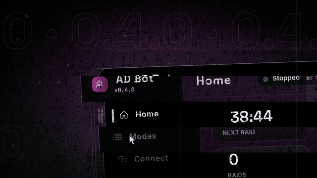
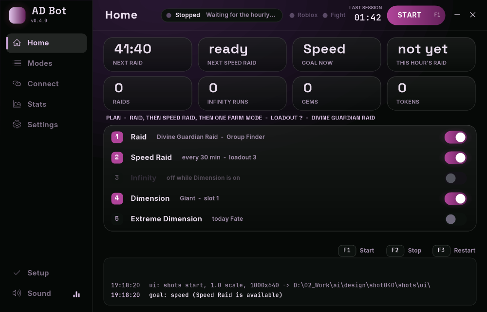
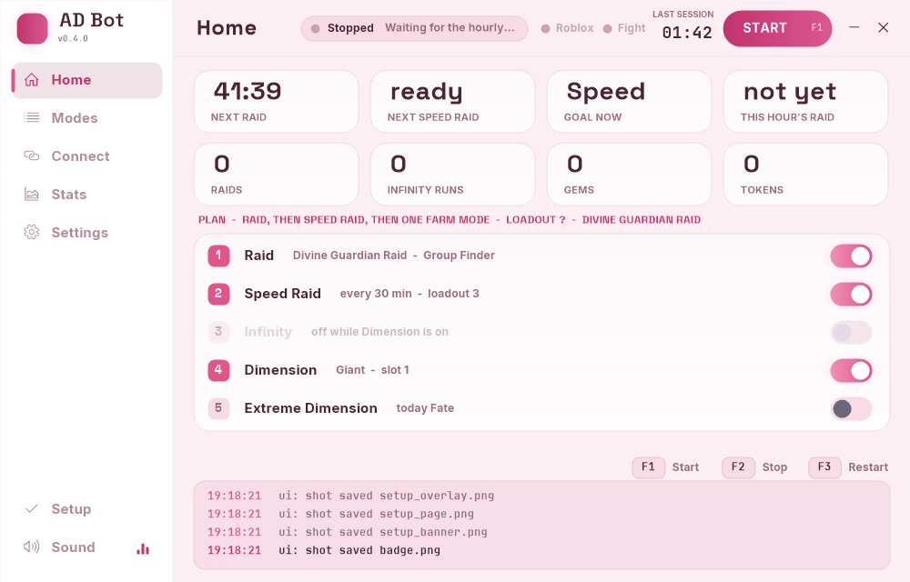

# AD/BOT

**Farming bot for Anime Dimensions Simulator (Roblox) that keeps going when Roblox itself fails.**

> [!WARNING]
> **The browser or Windows Defender may block the download and call it a virus. It is a false alarm.**
> What triggers it is the **Discord webhook** (`webhook.ahk`): the bot can send its reports to your Discord channel, and antivirus programs do not like scripts that send data to the internet. It only sends when you put your own webhook link in **Discord**, and only to that link. Every file is a plain-text `.ahk` script, so you can open it and read what it does.
> To download anyway: in Chrome open **Downloads** and press **Keep**; in Windows Defender open **Protection history** and press **Allow**.

> Roblox disconnects, freezes on a teleport, loops a retry screen or just closes? AD/BOT was made for players for whom this happens **all the time**. It notices the problem, restarts the game, joins again and carries on, so your night run does not end at the first crash.

## ✨ New in 0.4.0

| | |
|---|---|
| 🎨 **HUD 2.0** | A new full window: Home, Modes, Connect, Stats, Settings and Setup pages, a plan of what the bot does next, animations, click sounds and 9 themes. The compact window is still there. |
| 🛡️ **Safe mode** | When the same mode keeps failing, the bot restarts the game, and after the 3rd problem in 2 hours it pauses that mode for a while and farms something else. |
| 🔁 **Auto rejoin** | A frozen game (Not Responding, or the same picture for 3 minutes) is restarted, and a watchdog starts the bot again if it hangs. Your private server link is used after every restart. |
| 🎛️ **Recorder 2.0** | A new, simpler recorder that records every move and plays it back. |
| 📦 **Share runs** | Export your run to one `.adrun` file and Import a friend's run in the Recorder. |
| 🔥 **Extreme knows today's map** | The bot knows which Extreme map is open today and plays your own run for that map. |
| 💬 **Discord reports** | Put your webhook link in **Discord**: the bot posts what it did (raids, gems, problems), so you can watch it from your phone. |
| ⚔️ **Create room is back** | Raids can use your own room again, besides Group Finder. |
| ⏱️ **Raid start minute** | Your time zone is not a full hour away? Set the minute the raid opens (Modes > Raid, xx:00 by default). |

 HUD 2.0: the Home page in the dark and the light theme

<b>New in 0.3.5</b>

| | |
|---|---|
| 🔥 **Extreme Dimension** | Enters from the lobby, picks Easy / Normal / Nightmare / Extreme, presses Start, waits **Wait after Start** (15 s, also after Replay) and plays your recording from `dimension\extreme`. **It ships empty: record your own run.** While it is on, the normal Dimension is off. Uses loadout 2. |
| 🎃 **Halloween and Death Dimension** | New choices next to Giant. **No runs are included** - record your own with the Recorder. |
| 🗿 **Giant Dimension slots** | Slot 1 = the run from before (`dimension\giant`), Slot 2 = the built-in run, **Slot 3 = a new run by the author** (`dimension\giant3`), Slots 4-5 = your own. |
| ⚔️ **Raid picker and Group Finder** | Pick the raid from a list. The bot joins it through Group Finder and waits in the queue. |
| ⏱️ **LEAVE AT** | In System: the minute and second of the hour when the bot leaves for the raid. |
| 🩺 **Better Setup check** | Checks that Roblox runs first, then really looks for the PLAY button, reads the scale of the monitor the game is on, warns about a self-hiding taskbar. After **Stop**, a yellow plate tells what went wrong and how to fix it. |
| 🌗 **Light theme** | Sun / moon switch at the top of the compact window. |

> **Loadouts:** keep the original names in the Bag - **Loadout 1** (raid), **Loadout 2** (Infinity, Dimension, Extreme), **Loadout 3** (Speed Raid). Do not rename them: the bot finds them by name.

<b>New in 0.3.1</b>

| | |
|---|---|
| 🪟 **New compact interface** | A small window with all settings in fold-out groups. Opens by default after the first Setup check. |
| 🖥️ **Classic interface, improved** | Still here: **FULL UI** in the System group or **CHARACTER & STATS**. |
| 🗿 **Giant Dimension** | Plays a recorded run instead of Infinity. Method 1 = `dimension\giant\log.txt`, Method 2 = built-in run, or your own recording in `dimension\giant2\log.txt`. |
| 🎛️ **Recorder** | `Edit the run`: Wait +/-100 ms, add key press / key down / key up, edit or delete rows. |
| 🎵 **Music** | Plays in the compact window. Turn it off in System > MUSIC, or add your own `.m4a` to `music`. |
| 🧭 **Smarter lobby check** | Lobby is also found by the **BAG** text when PLAY cannot be read (e.g. under the "Activate Windows" watermark). |
| 🔗 **Private server links** | Old `privateServerLinkCode` links open straight in Roblox; a failed link falls back to the plain game start. |

## 🩹 Recent fixes

- **Recorder 2.0 rebuilt for exact replays** - no more stuck keys or missing presses (quick taps, keys from macro software), camera turns recorded over RDP / virtual machines / Parsec / tablets, the camera no longer drifts up on clicks with shift-lock, the replay uses the recording PC's Windows mouse settings (put back after), 1 ms timing, clicks no longer 0.1 s late, middle and side mouse buttons recorded, sensitivity field works like in Roblox (3 = 3.00). Record your runs again for the best result.
- **Restart stuck on the Roblox Sign In page** - the Roblox app keeps logging itself out, so after a restart the game stayed on Sign In. The bot now sees that page and starts the game through your browser instead. Stay signed in at roblox.com in your default browser and tick "Always allow" on the "Open Roblox?" prompt once.
- **Recorder 2.0 lost actions** - keys stopped being recorded after about 30 s, clicks with Shift/Ctrl/Alt were missed and keys could stay held. All fixed; the camera no longer jumps when a mouse button is released during replay.
- **Loadout not changed ("Loudoutl")** - the text recognition sometimes glued the 1 to the word, so the bot did not see Loadout 1 and never switched. It now reads that as 1 too.
- **Raid cut by a restart** - if the game was restarted in the middle of a raid, the bot thought the raid was done for that hour. Now it joins the raid again.
- **Raid seen as the lobby** - in the middle of a raid the bot sometimes saw PLAY or the mode cards, left for Dimension and the game was closed. The AUTO button now tells it that it is still in a run.
- **Raids not counted** - raids joined through Group Finder never showed up in "raids" (stats, session summary). Now every raid is counted once at the end of the fight, and the raid rewards are read from the REWARDS cards first.
- **Dimension not found in the list** - on a slow PC the list did not scroll in time and the bot gave up after one look. Now it reads the list a few more times before deciding the name is not there.
- **AUTO in raids** - AUTO is found by its colours when the pictures do not match, and the click is taken by the game again.
- **Run after RETRY** - after RETRY the bot waits until the character can walk before playing the recorded run.
- **Loadout switch** - waits longer and tries again if the Bag did not open.
- **Reports** - Setup check saves a screenshot, and Send report adds the screenshots of a failed loadout or a missing AUTO button.
- **Stuck after RETRY** - sometimes after RETRY the game froze on the results with only LEAVE and the bot just waited. Now after 20 s of an unknown screen the bot looks at the results again, presses LEAVE, and restarts the game if that does not help.
- **Stuck in the PLAY menu** - if the bot did not recognise the Dimension card in the PLAY menu, it waited there for minutes. Now after 30 s it closes the menu and looks again.
- **Stuck on Dimension results** - sometimes the game shows the results with only LEAVE and "Teleporting in 0", and never teleports. The bot waited there up to 10 min. Now it presses LEAVE by itself, and if the screen is still there 25 s later, it restarts the game.
- **Dimension gems** - the Dimension results screen changed and gems always showed 0. The bot now finds the gem card again and counts the gems.
- **No recorded run** - Halloween, Death and Extreme Dimension ship without a run. The bot no longer enters them (it used to get stuck inside): it tells you, skips the Dimension and goes on with the other modes. Record your run in the Recorder first.
- **Restart, PLAY not found** - if the PLAY button looks different (another font or style) and the screen is not recognised after a game restart, the bot presses PLAY at its usual place by itself. Setup check shows a yellow note when PLAY looks different.
- **Smaller report** - Send report now makes a 1-2 MB zip (it was 20+ MB and did not fit into Discord): screenshots are small JPEGs, only 10 are included, and your private server link is left out. The bot also saves screenshots only when something goes wrong.
- **Dimension start** - the bot now waits 2 s after it sees the first enemies, before it plays the run. Fixes the character that used skills but did not walk right after joining. Change it in `raid.ini` > `[raid]` > `dimWait=` (ms, 0 = start at once).
- **Recorder, + Wait row** - the Wait window opened behind the Recorder (it stays on top), so the button seemed to do nothing. It now opens on top; with no row selected the wait goes to the end.
- **OCR help** - when text recognition fails, Setup check now also shows the Windows command that installs the English OCR (the Language & region page often does not offer it).
- **Leaving Infinity** - the bot now looks for the results screen every 0.8 s instead of 2.5 s (also after a death), so it presses LEAVE before the game's own AUTO RETRY does.
- **Setup check needs Roblox open** - Continue stays locked until Roblox is running, so the full check (window size, keyboard layout) really runs.
- **Setup check** - now shows a yellow warning when the screen is not 1920x1080 or the Windows scale is not 100% (the bot is tuned for those; other values may work but are not tested).
- **Stuck in the lobby ("loadout first ... closing the menu")** - on a bright lobby or map the bot could mistake the screen for the open modes menu, close it again and again, and never open the Bag. The looser button match from the last update is removed (it caused this), and the loadout is now set right after the menu is closed. If the buttons are not found on your PC, set the Windows scale to 100%.
- **Loadout never changes (button reads "Loudout")** - in the game's Bag the loadout button is spelled "Loudout 3" (a typo in the game). The bot looked for "Loadout", never recognised the button, tried three times and stayed on loadout 1 for every mode. It now reads both spellings.
- **Setup check, hidden taskbar** - a taskbar that hides itself is now a yellow warning on its own row (before it was green, and the text sat under the display scale). The scale row only talks about the scale.
- **Gems not counted** - after a game update the gem and token card pictures no longer matched, so Dimension and Speed Raid gems stayed at 0. New pictures and a looser match.
- **Restart through the browser** - after closing Roblox the bot now presses the big blue **Play** button on the game page first (the Roblox app stayed signed out when started without the browser and showed its sign-in page forever). **Join** on the Servers tab and `roblox://` are the backups.
- **Loadout switch** - the modes menu could stay open after leaving a Dimension and cover the BAG button, so the loadout was never changed. The bot now closes the menu before retrying.
- **Dimension, Method 2** - your own recording now saves to its own folder `dimension\giant2`, so it no longer replaces the Method 1 run.
- **Start-up error** - fixed "uiLog has not been assigned" when the bot logs or closes during start-up.

## 🛠️ When Roblox breaks

- **Disconnected / Error 279** - closes Roblox and joins again.
- **Roblox crashed or closed** - starts the game again.
- **Stuck on "Teleporting"** - presses LEAVE, restarts the game if that does not help.
- **Infinity Auto Retry loop** - presses LEAVE on the results screen.
- **Unknown screen or stuck menu** - Esc, then closing windows, then a game restart.
- **Wrong window size, fullscreen or keyboard layout** - fixed before the start.
- **Every restart** saves a screenshot and a log line with the reason.

## ⚔️ What it farms

- **Raid** - every hour, with the game's **Auto** button; gems and tokens are read from the results.
- **Speed Raid** - every 30 minutes with the next unused character.
- **Infinity** or **Giant Dimension** - between raids.
- A short summary (raids, gems, tokens, runs, restarts) is written to the log when you stop the bot.

## 📋 What you need

- Windows 10 / 11 and [AutoHotkey v2](https://www.autohotkey.com/)
- Screen **1920x1080**, Windows scale **100%**, taskbar at the bottom
- Roblox desktop app in a normal window (not F11). The bot sets the window size itself.
- Roblox language **English**, English OCR language pack in Windows
- Screen lock and screensaver off
- Optional: lowest graphics; loadout 1 = raid, 2 = Infinity / Dimension, 3 = Speed Raid (keep the original loadout names)

## 🚀 How to start

1. **Code > Download ZIP** and unpack it.
2. Open Roblox, join the game and wait in the lobby.
3. Run `RaidBot.ahk`. Press **Check now**, fix what it shows, then **Continue** - the compact window opens.
4. Pick the raid and modes.
5. **F1** start · **F2** stop · **F3** reload.

<b>Private server</b>

After a restart the bot starts the game on a public server. To come back to your private server, put `serverLink=<your link>` under `[raid]` in `raid.ini`.

## ⚠️ Good to know

- Tested on one setup (1920x1080, one account). Other settings can break image matching.
- The bot uses your mouse and keyboard, so you cannot use the PC while it runs.
- A disconnect is noticed after about 1.5 minutes.
- Automating Roblox games may break the rules of Roblox or the game. **Use at your own risk.**

Found a problem? Run `Send_Report.bat` and send the zip to the author, or open an issue.

made by Samogub

