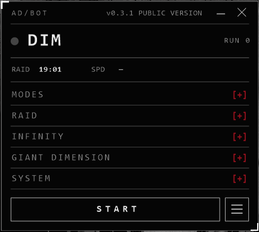
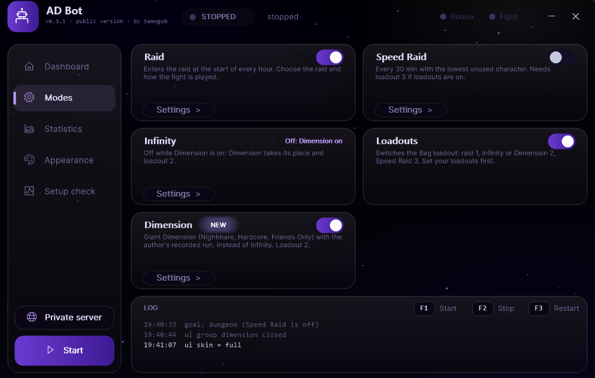

# AD/BOT

**Farming bot for Anime Dimensions Simulator (Roblox) that keeps going when Roblox itself fails.**

> Roblox disconnects, freezes on a teleport, loops a retry screen or just closes? AD/BOT was made for players for whom this happens **all the time**. It notices the problem, restarts the game, joins again and carries on, so your night run does not end at the first crash.

## ✨ New in 0.3.1

| | |
|---|---|
| 🪟 **New compact interface** | A small window with all settings in fold-out groups. Opens by default after the first Setup check. |
| 🖥️ **Classic interface, improved** | Still here: **FULL UI** in the System group or **CHARACTER & STATS**. |
| 🗿 **Giant Dimension** | Plays a recorded run instead of Infinity. Method 1 = `dimension\giant\log.txt`, Method 2 = built-in run, or your own recording in `dimension\giant2\log.txt`. |
| 🎛️ **Recorder** | `Edit the run`: Wait +/-100 ms, add key press / key down / key up, edit or delete rows. |
| 🎵 **Music** | Plays in the compact window. Turn it off in System > MUSIC, or add your own `.m4a` to `music`. |
| 🧭 **Smarter lobby check** | Lobby is also found by the **BAG** text when PLAY cannot be read (e.g. under the "Activate Windows" watermark). |
| 🔗 **Private server links** | Old `privateServerLinkCode` links open straight in Roblox; a failed link falls back to the plain game start. |

## 🩹 Recent fixes

- **Modes menu not recognised** - on some PCs (for example 1920x1200 with Windows scale 125%) the Speed Raid / Dimension buttons were never found. The match is now looser, with a safety check against false hits.
- **Gems not counted** - after a game update the gem and token card pictures no longer matched, so Dimension and Speed Raid gems stayed at 0. New pictures and a looser match.
- **Restart through the browser** - after closing Roblox the bot now presses the big blue **Play** button on the game page first (the Roblox app stayed signed out when started without the browser and showed its sign-in page forever). **Join** on the Servers tab and `roblox://` are the backups.
- **Loadout switch** - the modes menu could stay open after leaving a Dimension and cover the BAG button, so the loadout was never changed. The bot now closes the menu before retrying.
- **Dimension, Method 2** - your own recording now saves to its own folder `dimension\giant2`, so it no longer replaces the Method 1 run.
- **Start-up error** - fixed "uiLog has not been assigned" when the bot logs or closes during start-up.

<table>
<tr>
<td align="center"> Compact window</td>
<td align="center"> Classic window</td>
</tr>
</table>

## 🛠️ When Roblox breaks

- **Disconnected / Error 279** - closes Roblox and joins again.
- **Roblox crashed or closed** - starts the game again.
- **Stuck on "Teleporting"** - presses LEAVE, restarts the game if that does not help.
- **Infinity Auto Retry loop** - presses LEAVE on the results screen.
- **Unknown screen or stuck menu** - Esc, then closing windows, then a game restart.
- **Wrong window size, fullscreen or keyboard layout** - fixed before the start.
- **Every restart** saves a screenshot and a log line with the reason.

## ⚔️ What it farms

- **Raid** - every hour, with the game's **Auto** button; gems and tokens are read from the results.
- **Speed Raid** - every 30 minutes with the next unused character.
- **Infinity** or **Giant Dimension** - between raids.
- A short summary (raids, gems, tokens, runs, restarts) is written to the log when you stop the bot.

## 📋 What you need

- Windows 10 / 11 and [AutoHotkey v2](https://www.autohotkey.com/)
- Screen **1920x1080**, Windows scale **100%**, taskbar at the bottom
- Roblox desktop app in a normal window (not F11). The bot sets the window size itself.
- Roblox language **English**, English OCR language pack in Windows
- Screen lock and screensaver off
- Optional: lowest graphics; loadout 1 = raid, 2 = Infinity / Dimension, 3 = Speed Raid

## 🚀 How to start

1. **Code > Download ZIP** and unpack it.
2. Open Roblox, join the game and wait in the lobby.
3. Run `RaidBot.ahk`. Press **Check now**, fix what it shows, then **Continue** - the compact window opens.
4. Pick the raid and modes.
5. **F1** start · **F2** stop · **F3** reload.

<b>Private server</b>

After a restart the bot starts the game on a public server. To come back to your private server, put `serverLink=<your link>` under `[raid]` in `raid.ini`.

## ⚠️ Good to know

- Tested on one setup (1920x1080, one account). Other settings can break image matching.
- The bot uses your mouse and keyboard, so you cannot use the PC while it runs.
- A disconnect is noticed after about 1.5 minutes.
- Automating Roblox games may break the rules of Roblox or the game. **Use at your own risk.**

Found a problem? Run `Send_Report.bat` and send the zip to the author, or open an issue.

made by Samogub

